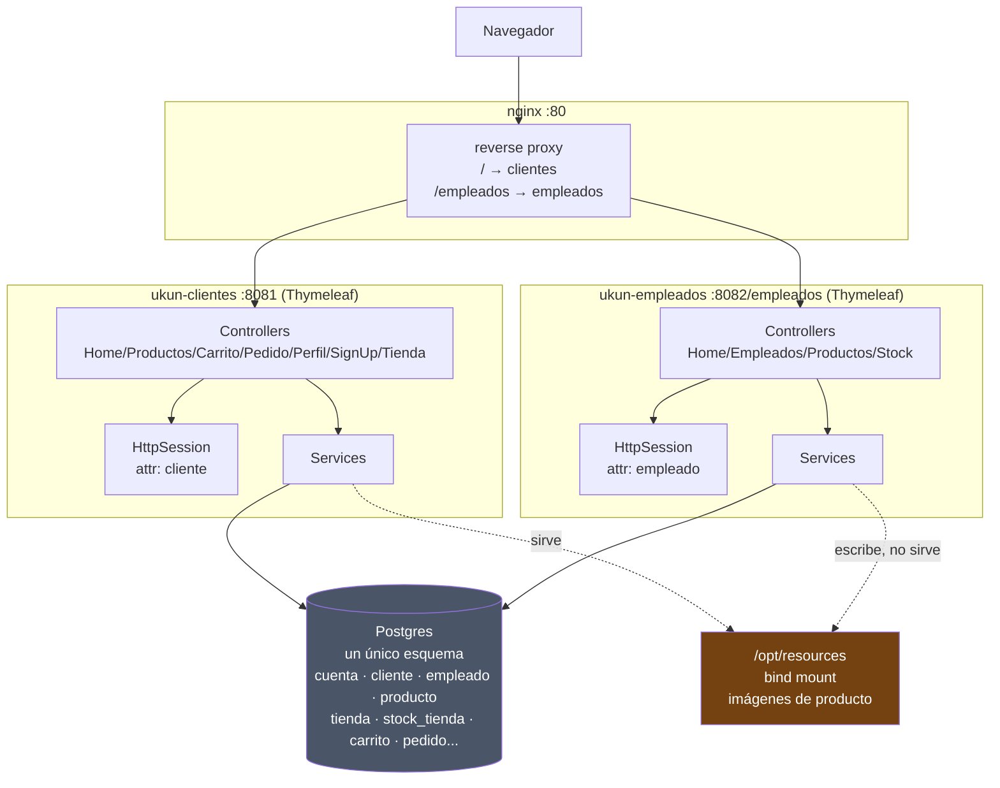
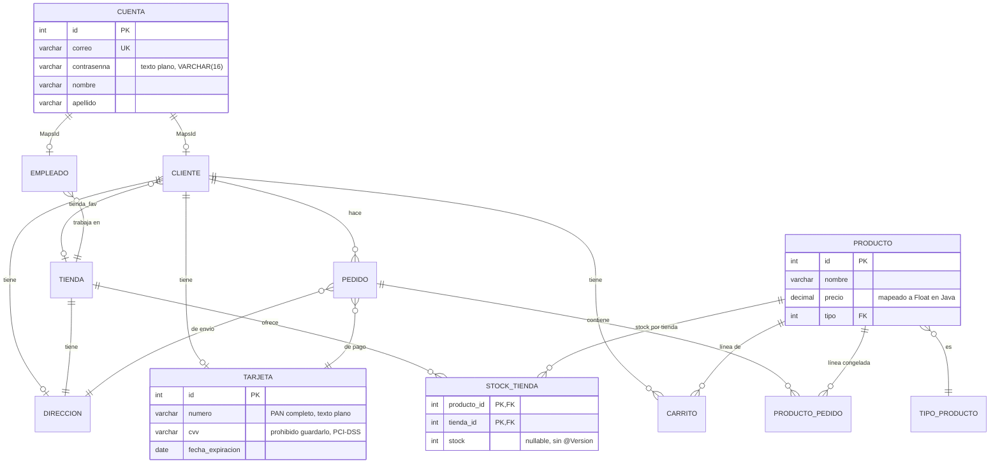
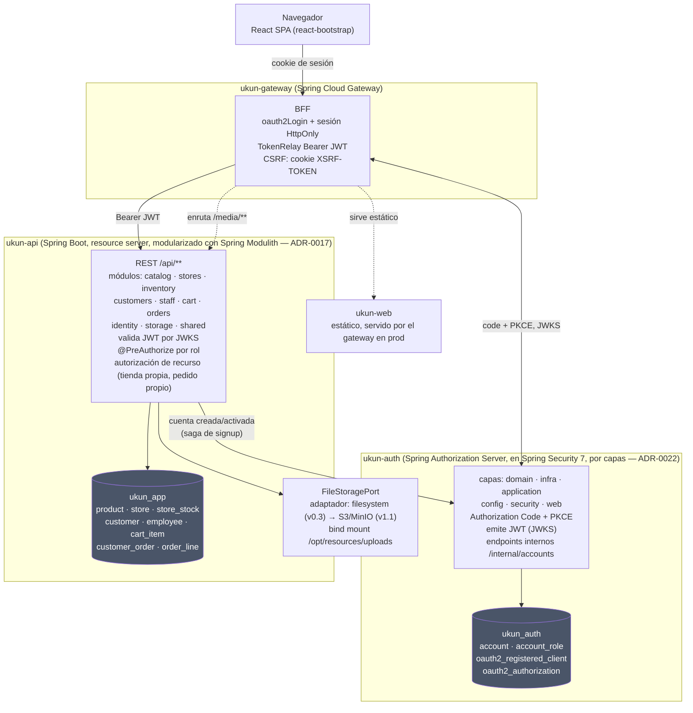
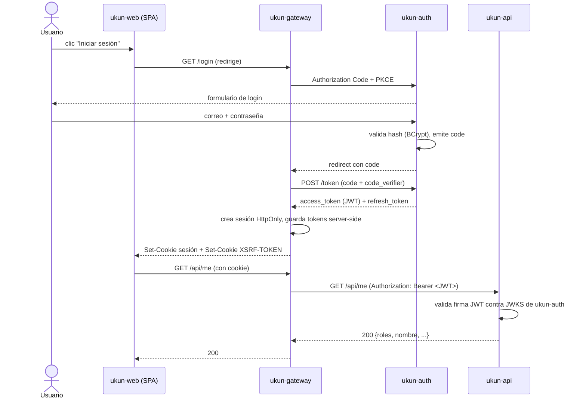
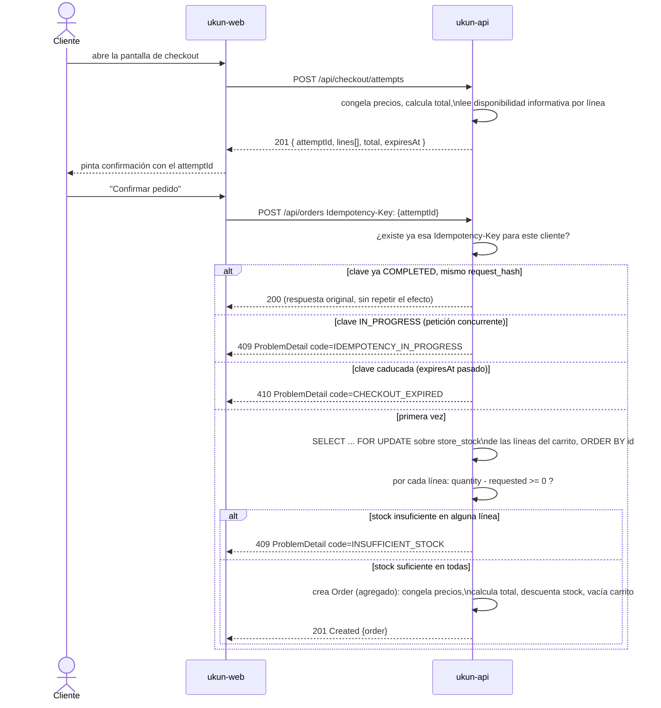

# Arquitectura: sistema legacy y sistema objetivo

> **Fuente de verdad de:** la forma del sistema — diagramas de contenedores, ER del legacy, y las secuencias de login y de checkout.
> **Léelo si:** quieres entender la forma del sistema de un vistazo, antes de entrar en detalle.
> **No decide:** el grafo de módulos (ADR-0017 / `14-modules.md`, se genera solo), ni el esquema objetivo columna a columna (`10-modelo-de-datos.md`).

## 1. Sistema legacy (referencia, no está en marcha)

Dos monolitos Spring Boot 3.2 / Java 17 independientes (sin código ni build compartido), cada uno con su propio Thymeleaf, atacando directamente la misma base Postgres. nginx solo enruta por prefijo de path, sin lógica. La autenticación es un atributo de `HttpSession` por app, sin Spring Security.

Este apartado está aquí porque `ukun-clientes`/`ukun-empleados` son la **especificación del comportamiento** que hay que conservar (`02-requisitos.md`) y el catálogo de lo que no hay que repetir (`03-analisis-y-patrones.md`), no porque haya que convivir con ellos: no corren, y no hay estrategia de coexistencia (`04-roadmap.md`).

**Lo que este diagrama ya explica sobre los defectos encontrados:** no hay ninguna frontera entre `cService` y `eService` — ambos escriben `producto`/`stock_tienda`/`cuenta` con entidades JPA distintas y ya divergentes (ver [`03-analisis-y-patrones.md`](./03-analisis-y-patrones.md)). `ukun-empleados` escribe en el volumen de imágenes pero no lo sirve (`WebConfig` sin `addResourceHandlers`); depende de que `ukun-clientes` esté vivo para que las fotos de producto se vean.

### Modelo de datos actual (entidad-relación)

`cuenta` es la tabla de identidad base; `cliente` y `empleado` heredan su PK vía `@MapsId` (table-per-type). Es exactamente el acoplamiento que el diseño nuevo no reproduce: con la identidad en otra base, `customer.id` es clave propia y la cuenta se referencia como `account_id UUID` sin FK — ver [`08-identidad-y-seguridad.md`](./08-identidad-y-seguridad.md) §1.

---

## 2. Sistema objetivo

Un monolito API de dominio, un servicio de autenticación separado, un gateway que actúa de BFF (Backend For Frontend) y un SPA en React. El navegador nunca ve un token JWT: solo una cookie de sesión HttpOnly hacia el gateway.

**Módulos de `ukun-api`:** el diagrama de arriba solo nombra los módulos; el grafo completo de dependencias entre ellos (`allowedDependencies`, incluido el ciclo `catalog`↔`inventory` y cómo se rompe) vive en ADR-0017 y `docs/14-modules.md`, y se regenera automáticamente en cada build de desarrollo vía `Documenter` de Spring Modulith — no se mantiene un segundo diagrama a mano aquí.

`ukun-auth` **no** está modularizado con Modulith: es un servicio anémico de quince clases con estructura por capas (`domain`/`infra`/`application`/`config`/`security`), y no hay grafo que dibujar. ADR-0022 explica por qué se retiró.

**Por qué BFF y no token en el SPA:** el token nunca entra en el alcance de un XSS del navegador, no hay que resolver refresh silencioso desde JavaScript, y al ser el gateway el único origen que ve el navegador, desaparece CORS. El coste es que el gateway pasa a tener estado (sesión) — asumible con un solo gateway en dev y con sesión en memoria; en producción con más de una réplica se resuelve con Redis, no antes.

**Fronteras de datos:** `ukun-auth` es deliberadamente anémico — solo `account` y `account_role`. `name`/`last_name`/`email` (proyección) viven en `ukun-api` junto al resto del perfil, para que editar el perfil sea una única transacción local salvo cuando cambia el email o la contraseña. El detalle completo de esta frontera está en [`08-identidad-y-seguridad.md`](./08-identidad-y-seguridad.md).

### Secuencia: login con BFF

### Secuencia: checkout con concurrencia controlada e intento emitido por el servidor

Resuelve la race condition real de `PedidoServiceImpl.reducirStockOnline` (lectura-modificación-escritura sin bloqueo, hoy puede dejar stock negativo con dos pedidos simultáneos del mismo producto). Incorpora ADR-0016: el identificador de idempotencia lo emite el servidor al abrir el checkout, no el navegador.

El `ORDER BY id` antes del bloqueo (columna `id` propia de `store_stock` desde ADR-0015) es lo que evita interbloqueos cuando dos pedidos concurrentes comparten productos en distinto orden. Detalle completo del bloqueo en [`03-analisis-y-patrones.md`](./03-analisis-y-patrones.md#agregado-stock) y del intento de checkout en ADR-0016.
