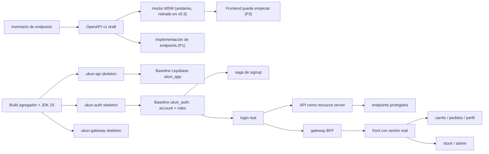
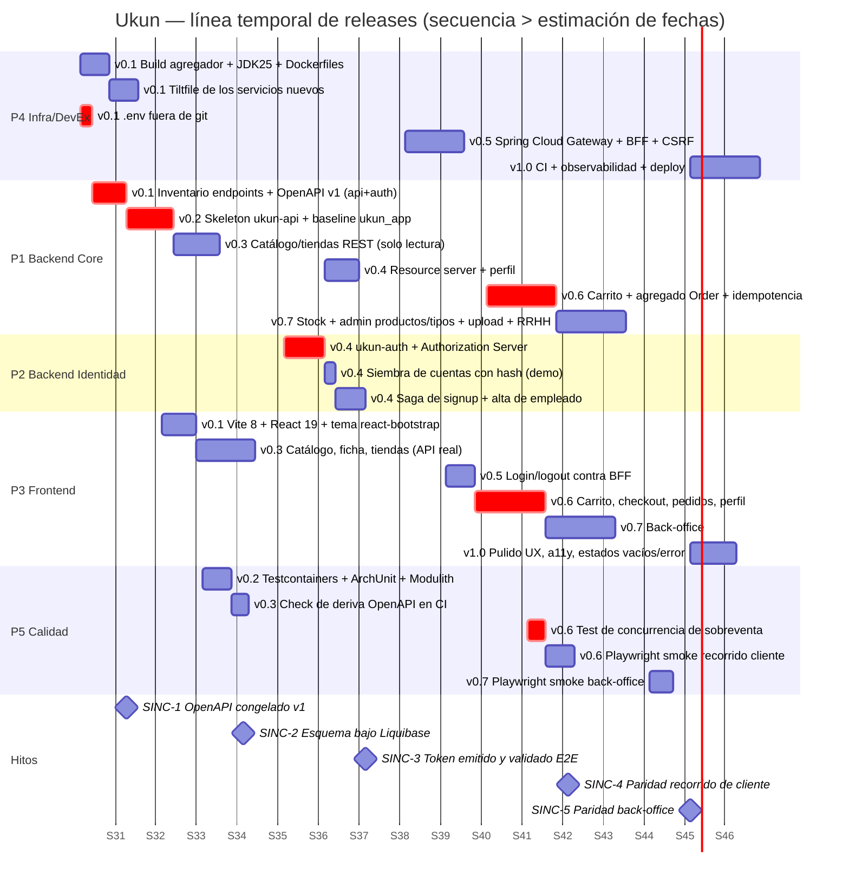

# Roadmap: línea temporal de releases

> **Fuente de verdad de:** qué entra en cada release, el grafo de dependencias entre trabajos y los puntos de sincronización.
> **Léelo si:** quieres saber qué toca ahora, si puedes adelantar trabajo, o cómo repartir tareas entre sesiones.
> **No decide:** cómo se implementa nada (skills), ni el detalle del esquema (`10-modelo-de-datos.md`), ni el contrato de errores (`12-error-contract.md`), ni **en qué estado está cada tarea** (issues de GitHub, ver abajo).

Sustituye a `REFACTOR-PLAN.md`. Organizado como **línea temporal de versiones**, no como fases estancas: cada release tiene una salida verificable. Dentro de cada release se indica qué trabajo es paralelizable entre sí.

Decisiones que ya han fijado esta línea temporal (ver `adr/`): frontend en **react-bootstrap** (migración mecánica del markup, no rediseño desde cero), autenticación con **BFF en el gateway**, datos actuales **desechables**, Tilt sobre **docker-compose**.

## Seguimiento de la ejecución

Este documento describe **qué hay que hacer y en qué orden**. El **estado** de cada tarea vive en los issues de GitHub, no aquí — un checklist en este fichero sería una segunda copia del plan que se desincroniza sola.

```bash
./scripts/roadmap-status.sh          # avance por release + abiertos por pista
./scripts/roadmap-status.sh v0.3     # issues abiertos y cerrados de un release
./scripts/roadmap-status.sh --next   # el release en curso
```

Correspondencia entre este documento y el tracker:

| Aquí | En GitHub |
|---|---|
| release (`v0.1`…`v1.1+`) | **milestone**, con la fecha de su hito como vencimiento |
| ítem paralelizable de un release | **issue** |
| pista (P1…P5) | label `pista:P1-backend-core`…`pista:P5-calidad` |
| hito `SINC-n` | issue con label `sinc` — bloquea lo que viene detrás |
| lo que `09-trabajo-con-agentes-ia.md` §5 no delega sin supervisión | label `revision-humana` |

Los issues **no repiten** las decisiones: cada uno enlaza el RF, el ADR y la skill de los que depende, y `/slice <release> <slice>` genera el encargo completo a partir de esas fuentes. Si un issue y este documento discrepan, manda este documento; corrige el issue.

Cerrar issues desde los commits (`closes #42`) mantiene la barra de progreso del milestone al día sin trabajo manual.

## Punto de partida: no hay nada corriendo

`ukun-clientes` y `ukun-empleados` **no están en servicio**. Están en el repo como especificación ejecutable de qué hace el negocio y como catálogo de defectos a no repetir — nada más. (`ukun-clientes/` ya se borró, en v0.6; se lee en el tag `v0.0-legacy`.) Esto tiene tres consecuencias que atraviesan todo el plan:

- **No hay estrategia de convivencia.** Ni *strangler fig*, ni enrutado por path entre legacy y nuevo, ni feature flags de infraestructura. Se construye el sistema nuevo y punto.
- **No hay migración de datos ni de esquema.** El esquema nace completo y en inglés en su baseline de Liquibase (`10-modelo-de-datos.md` §8, ADR-0018); no hay renombrados escalonados ni restricciones que entren en dos pasos por compatibilidad.
- **"Borrar el legacy" no es un hito de riesgo**, es limpieza de repositorio. Lo que sí es un hito real es la **paridad funcional**: que el sistema nuevo cubra el recorrido que el legacy documenta.

Lo que **sí** se conserva del legacy, y hay que tratar como requisito: los comportamientos de `02-requisitos.md` (incluidas las reglas de negocio marcadas como reales, p. ej. que el pedido descuenta solo de la tienda online) y la lista de defectos de `03-analisis-y-patrones.md` §1, que es lo que el diseño nuevo tiene que evitar reproducir.

> Si esto lo ejecuta una sola persona con ayuda de agentes de Claude Code, "paralelizable" significa *"puedes reordenar y repartir estas tareas entre sesiones libremente sin que se pisen"*, no necesariamente "ocurre literalmente a la vez". El grafo de dependencias es el valor real de esta sección — ver también `09-trabajo-con-agentes-ia.md` y la skill `slice`.

## Pistas de trabajo

| Pista | Alcance | Puede avanzar mientras... |
|---|---|---|
| **P1 · Backend Core** | `ukun-api`: dominio, endpoints REST, Liquibase de `ukun_app` | exista el OpenAPI acordado |
| **P2 · Backend Identidad** | `ukun-auth`, siembra de cuentas, saga de signup | el contrato `/internal/accounts` esté fijado |
| **P3 · Frontend** | React + react-bootstrap, rutas, componentes | exista el OpenAPI (en v0.1–v0.2, con mocks MSW; desde v0.3, contra `ukun-api` levantado) |
| **P4 · Infra/DevEx** | Tilt, composes, Dockerfiles, gateway, CI | nada — es la primera en arrancar |
| **P5 · Calidad** | Testcontainers, ArchUnit, Playwright, check de deriva de contrato | exista al menos un endpoint |

## Grafo de prerrequisitos duros



## Artefactos-contrato que desbloquean paralelismo

1. **`docs/api/openapi/ukun-api.yaml`** escrito a mano en v0.1, *antes* de que exista implementación (design-first). Es lo que permite que P3 empiece en la primera semana y no cuando el backend "esté listo".
2. **Tipos generados del OpenAPI** (`openapi-typescript`), permanentes. Los **mocks MSW de navegador** fueron el andamio que permitió a P3 empezar en v0.1 sin backend, y como todo andamio tienen fecha de caducidad: se retiran al cerrar v0.3, cuando el frontend ya consume `ukun-api` de verdad. Mantener los dos vivos a la vez es pagar un segundo backend para que mienta cada vez mejor. Desde entonces MSW existe solo dentro de Vitest (`13-testing.md` §2).
3. **Check de deriva en CI**: se levanta `ukun-api`, se descarga `/v3/api-docs` (springdoc) y se diffea contra el YAML versionado. El build falla si divergen — contract testing sin traer Pact.
4. **Contexts de Liquibase** (`demo`/`prod`): mismos changelogs de esquema, distintos datos, sin scripts paralelos.

## Timeline



## Detalle por release

### v0.1 — Cimientos
*Salida: `tilt up` levanta el stack nuevo; el contrato OpenAPI existe.*

Paralelizable:

- (a) Build agregador + JDK 25 + **Dockerfiles de producción** de los tres servicios Java (jar en capas, usuario no root, `HEALTHCHECK`, `ENTRYPOINT` con nombre de jar fijo, caché de BuildKit para `~/.gradle` — `06-entorno-local-tilt.md`). El build es Gradle desde ADR-0021.
- (b) `Tiltfile` + `compose.yaml` de los servicios nuevos, con live update.
- (c) **Inventario de endpoints** recorriendo los 12 controllers legacy → `docs/02-requisitos.md` → `ukun-api.yaml`/`ukun-auth.yaml`, **en inglés desde el primer borrador** (ADR-0018): `/api/products`, `/api/product-types`, `/api/stores`, `/api/availability` (endpoint separado de `/api/products`, consecuencia del ciclo `catalog`↔`inventory` resuelto en ADR-0017 §3), `/api/checkout/attempts` + los cuatro `code`s de error asociados (ADR-0016, `docs/12-error-contract.md`), `/api/cart`, `/api/orders`, `/api/me/profile` (con el campo `locale`, ADR-0019), `/api/signup` (público, lo orquesta el API — `08-identidad-y-seguridad.md` §3), `/api/stores/{storeId}/stock/{lineId}`, y toda la superficie solo-`admin` bajo **`/api/admin/**`** (ADR-0020): CRUD de productos con descatalogación y subida de imagen (RF-10), CRUD de tipos de producto (RF-13) y gestión de empleados (`/api/admin/employees`, RF-11 — antes se planificó como `/api/employees`).
  Los **dos** contratos entran en este mismo ítem, con la superficie repartida según la frontera de servicios de ADR-0003/ADR-0004: `ukun-api.yaml` todo lo anterior; `ukun-auth.yaml` únicamente el contrato interno `/internal/accounts` + `:activate`/`:release` (`client_credentials`, scope `accounts:write`, nunca lo llama el navegador). Los endpoints OAuth2/OIDC del Authorization Server no se documentan a mano — son estándar y los publica su propio `/.well-known/openid-configuration`.
- (d) `.env` fuera de git.
- (e) Scaffolding de `apps/ukun-web` (Vite 8, React 19, router, tema react-bootstrap unificado, esqueleto de i18n con react-i18next — ADR-0019).
- (f) **Colección Bruno** versionada en `docs/api/bruno/` + springdoc/Swagger UI en `ukun-api` (`06-entorno-local-tilt.md`).

Sincronización obligatoria al final: **SINC-1 (2026-08-11), OpenAPI v1 congelado**. Antes de esa fecha deben estar cerrados los cinco cambios de contrato que fuerzan ADR-0016/ADR-0017/ADR-0019/ADR-0020: el endpoint de intento de checkout, la separación `/api/products`/`/api/availability`, la ruta de línea de stock, el campo `locale` en `/api/me`, y el prefijo `/api/admin/**` con la superficie de RF-10 y RF-13 completa. A partir de SINC-1, P3 avanza contra mocks sin depender de nadie.

### v0.2 — Esqueleto y esquema
*Salida: `ukun-api` arranca contra un `ukun_app` completo y versionado.*

Paralelizable: (a) skeleton de `ukun-api` con Boot 4.1, ya con los `package-info.java` de los diez módulos de Spring Modulith declarados vacíos (`catalog`, `stores`, `storage`, `identity`, `inventory`, `customers`, `staff`, `cart`, `orders`, `shared`) y el `ModulithTest`/`verify()` desde el primer commit — ADR-0017, `docs/14-modules.md` · (b) **baseline de Liquibase de `ukun_app`**: todas las tablas con sus tipos, `CHECK`, `UNIQUE`, índices y `ON DELETE` definitivos (`10-modelo-de-datos.md` §8) · (c) datos demo como changelog con `context: demo` · (d) Testcontainers + ArchUnit desde el minuto cero.

El baseline entra completo de una vez porque no hay ni datos que preservar ni lector legacy que romper — el detalle columna a columna, con la consulta que justifica cada índice, está en `10-modelo-de-datos.md`.

### v0.3 — Catálogo REST + primer frontend real
*Salida: React consume datos reales de lectura.*

Paralelizable: los 6 endpoints (`/api/products` paginado+filtros, `/api/products/{id}`, `/api/products/suggest`, `/api/product-types`, `/api/stores`, `/api/availability`) son slices verticales independientes; las 3 pantallas del front que los consumen también lo son. Aquí se estrena la plantilla arquitectónica completa (DTO record, `ProblemDetail`, `@EntityGraph`, `Page<T>`) sobre el caso más barato del dominio, a propósito. Entran también las dos correcciones de consulta de RF-01: `unaccent` en la búsqueda por nombre (defecto #22) y desempate por `id` en todo `Sort` (defecto #23).

Dos matices que la palabra «paralelizable» esconde y que el orden de ejecución sí tiene que respetar:

- **El primer endpoint no es paralelo con los demás**: arrastra la infraestructura compartida del módulo `shared` (el `@RestControllerAdvice` con los cinco `code`s marcados como v0.3 en `12-error-contract.md`, la configuración de MapStruct, los parámetros de paginación). Hasta que ese primer slice esté mergeado, los otros cinco no tienen plantilla que copiar. Las dos correcciones de RF-01 van **dentro** de ese primer slice, no después: el contrato de `listProducts` ya las exige, y separarlas obliga a reescribir la consulta y sus ITs. La `unaccent` necesita además un changeset propio bajo `releases/` — el baseline solo crea `citext`.
- **`/api/availability` es del módulo `inventory`, no de `catalog`** (ADR-0017 §3). Es el endpoint que permite a la pantalla de catálogo pintar disponibilidad sin que `catalog` importe `inventory`.
- **La mitad de lectura del módulo `storage` se adelantó aquí desde v0.7**, no estaba en el plan original de este release. El catálogo entrega una `imageUrl` servible desde su primer endpoint, y no había nadie al otro lado: toda foto de producto era un 404 en cuanto la pantalla de catálogo se conectó al backend real. Son `FileStoragePort`, el adaptador de filesystem y la ruta pública `GET /media/products/{key}`, con el bind mount de `resources/uploads` en `compose.yaml`. La **subida** de RF-10 se queda en v0.7.
- **Cerrar v0.3 incluye retirar los mocks de navegador**, no dejarlos como alternativa: fuera el service worker, `VITE_ENABLE_MSW` y los handlers generados del OpenAPI. Una vez que el frontend consume el API real, un modo mock paralelo solo esconde los fallos que importan (una consulta mal formada, una cabecera que falta, latencia) hasta que ya no se pueden atribuir al cambio que los causó. MSW se queda como dependencia de test (`13-testing.md` §2).

### v0.4 — Identidad
*Salida: hay cuentas reales, con hash, y el API valida tokens.*

Paralelizable: (a) `ukun-auth` — Authorization Server + clientes OAuth2 registrados + **baseline de `ukun_auth`** · (b) siembra de cuentas demo con contraseña hasheada · (c) `ukun-api` como resource server · (d) saga de signup.

Este release es donde `ukun-auth` deja de ser una decisión de papel: implementarlo mostró que los tres módulos de Spring Modulith que ADR-0017 §4 le asignaba no compraban nada en un servicio que **ya es** la extracción que Modulith prepara. **ADR-0022** los retira y lo aplana a capas; `ukun-api` no cambia.

Punto de sincronización interno: (c) necesita que (a) publique el JWKS; (d) necesita (b) y (c). Detalle completo de la frontera de datos y la saga en `08-identidad-y-seguridad.md`.

### v0.5 — Gateway y BFF
*Salida: un único punto de entrada, login real en el navegador.*

Paralelizable: (a) rutas + filtros del gateway · (b) `oauth2Login` + sesión + cookie `XSRF-TOKEN` · (c) pantallas de login/logout/callback en React.

**SINC-3**: token emitido por auth, relevado por el gateway, validado por el API — un `GET /api/me` que responde 200 desde el navegador. Desbloquea todo lo protegido.

Aquí entra también **tracing** (`micrometer-tracing` en los tres servicios, `11-observabilidad-y-logging.md`): antes de este release hay un solo proceso por petición y un `traceId` no aporta nada; a partir de aquí una petición del navegador cruza gateway→auth→api y sin correlación la saga de signup no se puede depurar.

### v0.6 — Recorrido de cliente completo
*Salida: paridad funcional con `ukun-clientes` — borrado ya del repo (issue #40); se lee en el tag `v0.0-legacy`.*

Paralelizable en tres slices verticales independientes (backend + frontend cada una): **carrito** · **pedidos/checkout** · **perfil**. Solo checkout depende de carrito.

Aquí vive el trabajo de dominio serio: agregado `Order` con sus invariantes, bloqueo pesimista ordenado sobre `store_stock` (`ORDER BY id`, ADR-0015), idempotencia de `POST /api/orders` con el intento emitido por el servidor (`POST /api/checkout/attempts`, ADR-0016), e instantáneas inmutables de envío y pago en `customer_order` (ADR-0011 — corrige el defecto #19, que es el peor bug de comportamiento del legacy). El test de concurrencia de sobreventa es condición de salida, no un extra.

**Una cuarta slice de frontend que este plan no listaba: la pantalla de alta** (RF-06, issue #129). El backend la tenía desde v0.4 —la saga de signup— y el SPA ofrecía «Crear cuenta» como botón apagado, así que el recorrido que declara la paridad no tenía por dónde empezar: `03-analisis-y-patrones.md` §3 dice «cliente completo (signup → compra)», literalmente. Salió al preparar el smoke, que es cuando se nota que falta una puerta.

**SINC-4**: smokes de Playwright del recorrido cliente en verde → paridad declarada.

### v0.7 — Back-office completo
*Salida: paridad funcional con `ukun-empleados` — se borran `ukun-empleados/`, `nginx/`, `database/` y los composes legacy del repo.*

Paralelizable: **stock** · **CRUD de productos + tipos de producto + subida de imagen** · **gestión de empleados**. Los tres son independientes entre sí; dentro del segundo, el CRUD de tipos (RF-13) va **antes** que el de productos, porque dar de alta un producto exige elegir un tipo y es la primera pantalla que necesita el admin en una base recién creada.

Dentro del slice de stock entra `GET /api/products/by-sku/{sku}`: es el paso previo en pantalla al alta de una línea (el empleado teclea el SKU y lo resuelve antes de crear la línea), y solo resuelve productos activos, de forma que un producto descatalogado no se pueda reponer (ADR-0013, ADR-0015).

Aquí entra también la tabla `audit_log` en uso (`11-observabilidad-y-logging.md`, ADR-0014). Del `FileStoragePort` (ADR-0017) queda solo la **escritura**: el puerto, su adaptador de filesystem y la ruta pública de lectura se adelantaron a v0.3 porque el catálogo ya servía `imageUrl`. Lo que se implementa aquí es `store(...)` con el reemplazo compensado que exige `08-identidad-y-seguridad.md` §9, el multipart y su límite de 5 MB — y quitar el `:ro` del bind mount de `compose.yaml`.

### v1.0 — Endurecimiento

Sin funcionalidad nueva. CI (build + tests + check de deriva de OpenAPI + escaneo de dependencias), observabilidad (Actuator + Micrometer + OTLP), rate limiting en el gateway, accesibilidad y estados vacío/carga/error en React, despliegue en **Azure Container Apps** con infraestructura efímera descrita en Bicep (ADR-0023 — sustituye al despliegue Azure del legacy, no lo recupera), `docker-compose-azure.yml` borrado, documentación y ADRs al día.

### v1.1+ / v2.0 — Post-paridad
*Ya no es refactor, es evolución de producto.*

Almacenamiento de objetos (S3/MinIO) sustituyendo el bind mount `/opt/resources` — el `FileStoragePort` ya existe desde v0.7, así que es cambiar un adaptador. Máquina de estados del pedido (`CONFIRMED → PAID → SHIPPED → DELIVERED/CANCELLED`). Recogida en tienda física (hoy el pedido solo descuenta de la tienda online). Pasarela de pago real (resuelve también el problema PCI de la tabla `card`). Carrito anónimo con fusión al iniciar sesión. Kubernetes, si el destino de despliegue lo pide.

## Criterio de paridad

Sin ambigüedad: *un recorrido está a la par cuando está cubierto por React + `ukun-api`, todos los RF de `02-requisitos.md` que lo componen están implementados, y los smokes de Playwright de ese recorrido pasan en verde*. No antes, no "cuando parezca". El borrado de la carpeta legacy correspondiente es la consecuencia administrativa de haber declarado paridad, no el objetivo.

## Corrección respecto al `REFACTOR-PLAN.md` anterior

No se escriben tests de caracterización sobre `ukun-clientes`/`ukun-empleados`. Es código que no corre y que se borra; la especificación de comportamiento es el inventario de endpoints (`docs/02-requisitos.md`) y la validación de paridad la dan los smokes de Playwright contra el sistema nuevo.
